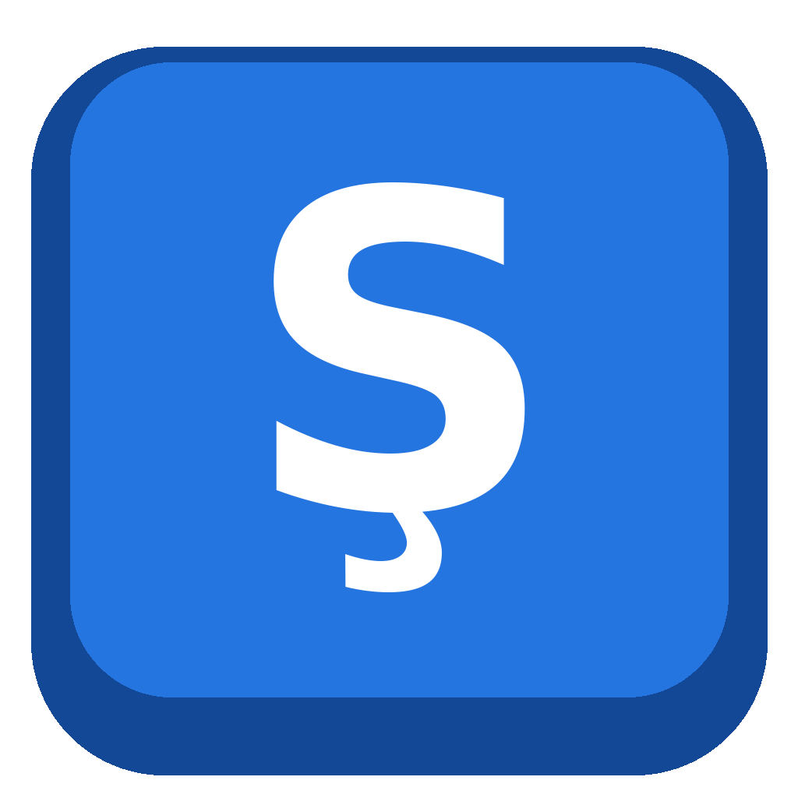

<p align="center">
  
</p>

<h1 align="center">Uzbek – yangi alifbo (AltGr)</h1>

<p align="center">
  Windows uchun yangi oʻzbek lotin alifbosi harflari: <b>ş ç ö ğ</b> va <b>ʼ</b><br>
  Oddiy US klaviatura + oʻng Alt (AltGr) tugmasi
</p>

<p align="center">
  <a href="../../releases/latest"><b>⬇ Yuklab olish</b></a> ·
  <a href="docs/TAHRIRLASH.md">Oʻzgartirish</a> ·
  <a href="README.en.md">English</a>
</p>

---

> **Diqqat!** bu **notijoriy loyiha**, koʻngilli ravishda qilingan ochiq kodli loyiha.
> Hech qanday davlat tashkiloti bilan bogʻliq emas.

## Nega bu loyiha?

Yangi oʻzbek lotin alifbosi harflari (**ş ç ö ğ**) uchun Windows'da hozircha rasmiy klaviatura yoʻq.
Bu loyiha **vaqtinchalik yechim**. Uning maqsadi: rasmiy paket chiqquncha bu harflarni oddiy klaviaturada qulay yozish.

- **Rasmiy paket chiqqanda** uni oʻrnating, keyin bu dasturni [oʻchirib tashlang](#oʻchirish). Ikkalasi bir vaqtda turishi ham mumkin, ular bir-biriga xalaqit bermaydi.
- Agar rasmiy alifboda harflar oʻzgarsa (masalan, boshqa harf tanlansa), bu loyiha ham imkon qadar yangilanadi.
  Yangiliklarni bilish uchun repozitoriyda **Watch → Custom → Releases** ni yoqing.
- Loyiha ochiq: muallif uni yangilay olmay qolsa ham, istalgan odam davom ettirishi mumkin.

## Nima qiladi?

Klaviaturangiz oddiy **US (QWERTY)** boʻlib qoladi. Faqat **oʻng Alt (AltGr)** bilan yangi harflar qoʻshiladi:

| Tugmalar | Natija | Shift bilan |
|---|:---:|:---:|
| AltGr + **S** | ş | Ş |
| AltGr + **C** | ç | Ç |
| AltGr + **O** | ö | Ö |
| AltGr + **G** | ğ | Ğ |
| AltGr + **`** (1 ning chapida) | ʼ (tutuq belgisi) | — |

- Caps Lock yoqilgan boʻlsa, AltGr harflari ham katta chiqadi.
- Chap Alt avvalgidek ishlaydi (Alt + Tab ga xalaqit bermaydi).
- Hech qanday dastur fonda ishlab turmaydi: bu Windows'ning oʻz klaviatura tizimi.

## Talablar

- Windows 10 yoki Windows 11
- 64-bitli (x64) kompyuter
- Administrator huquqi (oʻrnatish uchun)

32-bitli va ARM (masalan, Snapdragon) kompyuterlar hozircha qoʻllab-quvvatlanmaydi.

## Oʻrnatish

1. [Releases](../../releases/latest) sahifasidan `uzbek-yangi-alifbo-setup-X.Y.Z.exe` faylini yuklab oling.
2. Faylni ishga tushiring.
3. Ogohlantirish chiqsa, pastdagi [“Nega ogohlantirish chiqadi?”](#nega-ogohlantirish-chiqadi) boʻlimini oʻqing.
4. **Oʻrnatish** tugmasini bosing.
5. Kompyuterni **qayta yuklang**.
6. **Win + Space** ni bosib, **“Uzbek - yangi alifbo (AltGr)”** ni tanlang.

## Nega ogohlantirish chiqadi?

Windows ikki xil ogohlantirish koʻrsatishi mumkin:

- **“Windows protected your PC”** (koʻk oyna). Davom etish uchun **More info → Run anyway** ni bosing.
- **“Unknown publisher”** (Noma'lum nashriyotchi). **Yes** ni bosing.

Buning sababi: faylda pullik **raqamli imzo** (code signing) yoʻq. Bu fayl virus degani emas.
Ishonch hosil qilish uchun:

- Loyihaning butun manba kodi shu yerda ochiq turibdi.
- `setup.exe` GitHub Actions orqali shu koddan avtomatik yigʻiladi.
- Faylni [VirusTotal](https://www.virustotal.com) da tekshirishingiz mumkin.
- Yuklangan fayl buzilmaganini tekshirish uchun PowerShell'da quyidagini yozing va natijani Releases sahifasidagi `SHA256SUMS.txt` bilan solishtiring:

  ```powershell
  Get-FileHash .\uzbek-yangi-alifbo-setup-1.0.3.exe -Algorithm SHA256
  ```

## Oʻchirish

**Settings → Apps → Installed apps** boʻlimiga kiring. U yerda **“Uzbek yangi alifbo AltGr”** ni toping va **Uninstall** ni bosing.
Keyin kompyuterni qayta yuklang.

Agar u roʻyxatda koʻrinmasa, **Win + R** ni bosib `appwiz.cpl` deb yozing va oʻsha oynadan oʻchiring.

## Muammolar va yechimlar

**Windows yangilangandan keyin klaviatura yoʻqoldi.**
Oylik yangilanishlar klaviaturani oʻchirmaydi. Lekin katta versiya yangilanishida (masalan, 24H2 → 25H2) Windows baʼzan maxsus klaviaturalarni roʻyxatdan chiqarib yuboradi. Yechimi oson: **setup.exe ni qayta ishga tushiring** va kompyuterni qayta yuklang.

**Win + Space bosganda roʻyxatda yoʻq.**
1. Kompyuterni qayta yuklaganingizga ishonch hosil qiling.
2. **Settings → Time & language → Language & region** ga kiring. **Oʻzbek (lotin)** yonidagi **…** → **Language options** → **Add a keyboard** ni bosib, **“Uzbek - yangi alifbo (AltGr)”** ni tanlang.

**AltGr bosganda harf chiqmayapti.**
- Klaviatura toʻgʻri tanlanganini tekshiring (vazifalar panelining oʻng tomonida **UZ** yozuvi boʻlishi kerak).
- **Chap** Alt emas, **oʻng** Alt ni bosing.
- Noutbuklarda oʻng Alt oʻrniga **Ctrl + Alt** ni ishlatsangiz ham boʻladi.

**Baʼzi oʻyinlar yoki dasturlarda AltGr boshqacha ishlaydi.**
Baʼzi dasturlar Ctrl + Alt tugmalariga oʻz buyrugʻini biriktirgan boʻladi. Bu Windows'dagi barcha AltGr klaviaturalar uchun umumiy holat.

Boshqa muammo boʻlsa, [Issues](../../issues) boʻlimida yozing.

## Oʻzgartirish va oʻz versiyangizni yasash

Kod hammaga ochiq, xohlaganingizcha oʻzgartirishingiz mumkin. Masalan, boshqa harf qoʻshish, tugmani almashtirish yoki oʻz nomingiz bilan tarqatish.
Qadam-baqadam qoʻllanma: **[docs/TAHRIRLASH.md](docs/TAHRIRLASH.md)**

## Loyiha tuzilishi

```
src/uzaltgr.c        ← klaviatura jadvali (harflarni shu yerda oʻzgartirasiz)
src/kbd_min.h        ← Windows tuzilmalari (oʻzgartirish shart emas)
src/kbd.ld           ← linker skripti
src/uzaltgr.rc       ← versiya maʼlumoti
installer/setup.nsi  ← oʻrnatuvchi (NSIS)
tools/finalize.py    ← DLL ni yakunlash
build.sh             ← hammasini yigʻish (Linux)
VERSION              ← joriy versiya
```

## Texnik maʼlumot

Oʻrnatuvchi quyidagi ishlarni qiladi:

| Nima | Qayerga |
|---|---|
| `uzaltgr.dll` (64-bit) | `C:\Windows\System32\` |
| `uzaltgr.dll` (32-bit) | `C:\Windows\SysWOW64\` |
| Klaviatura yozuvi | `HKLM\SYSTEM\CurrentControlSet\Control\Keyboard Layouts\a0de0443` |
| Til roʻyxati | Oʻzbek (lotin) tiliga `0443:A0DE0443` qoʻshiladi |
| Oʻchirish dasturi | `C:\Program Files\Uzbek yangi alifbo AltGr\` |

Jim (sokin) oʻrnatish uchun: `setup.exe /S`. Jim oʻchirish uchun: `uninstall.exe /S`.

## Masʼuliyatdan voz kechish

Dastur **“boricha” (as is)** beriladi: hech qanday kafolatsiz. Muallif dasturdan foydalanish natijasida
yuzaga kelgan muammolar uchun javobgar emas (batafsil: [LICENSE](LICENSE)). Biz uni Windows 11 da sinab koʻrdik,
lekin har bir kompyuter va har bir Windows yangilanishida ishlashini kafolatlay olmaymiz.

## Litsenziya

[MIT](LICENSE). Bu dasturni bepul ishlatish, oʻzgartirish va tarqatish mumkin.
